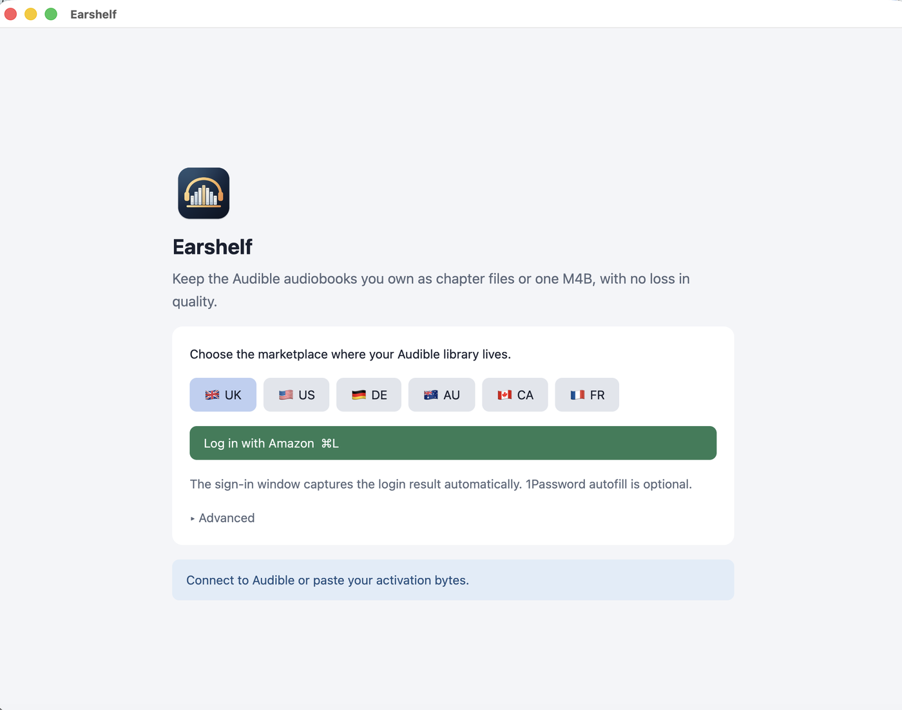

# Earshelf

**Keep the Audible audiobooks you own, in the format you choose.** Earshelf is a free, native Mac app that signs in to your Audible account, shows your library, downloads your books and saves them as lossless, DRM-free **M4B** (one file with chapters) or **M4A** (one file per chapter). No re-encoding, so the quality is identical to what you bought.


**For audiobooks you own only.** Use it to keep personal copies of books you bought on your own Audible account. Do not share or distribute them. You are responsible for following your local laws and Audible's terms. Earshelf is an independent project, not affiliated with or endorsed by Audible or Amazon.

## Install

**You need:** a Mac running macOS 12 or newer (Apple Silicon or Intel), an internet connection, and an Audible account. Nothing else: FFmpeg and Python tooling are included. Allow about 100 MB of disk space.

### 1. Install with one command

1. Open **Terminal**: press **⌘ Space**, type `Terminal`, press **Return**.
2. Paste this whole block and press **Return**:

   ```sh
   curl -fsSL https://github.com/Mokto/earshelf/releases/latest/download/Earshelf-macos-universal.zip -o /tmp/earshelf.zip
   ditto -x -k /tmp/earshelf.zip /Applications && rm /tmp/earshelf.zip
   ```

3. Open **Earshelf** from your Applications folder (or press **⌘ Space** and type `Earshelf`).

That's it. The first launch takes up to a minute, because Earshelf downloads Python and two small libraries once (about 30 MB, internet required). Later launches are instant.

> **Why Terminal and not a normal download?** Earshelf is free and open source, and its builds are not "notarized", which would require a paid Apple Developer account (US$99 a year). macOS blocks un-notarized apps you download in a browser. Files fetched with the command above are not blocked, so the app simply opens. Prefer a browser download? See below.

<details>
<summary><b>Download in a browser instead</b></summary>

1. Download `Earshelf-macos-universal.zip` from the [latest release](https://github.com/Mokto/earshelf/releases/latest) and double-click it to unzip.
2. Drag **Earshelf** into your **Applications** folder.
3. Double-click Earshelf. macOS says it "cannot be opened" or "could not verify" it. Click **Done** (or **OK**).
4. Open **System Settings → Privacy & Security**, scroll down to the message about Earshelf and click **Open Anyway**. Enter your password if asked, then click **Open**. You only do this once.
   - On macOS 12 to 14 you can instead **right-click Earshelf → Open → Open**.
   - Or, in Terminal: `xattr -dr com.apple.quarantine /Applications/Earshelf.app`

</details>

### 2. Sign in (once)



1. Pick the **marketplace** where your Audible library lives (UK, US, DE, AU, CA or FR). If unsure, choose the country of your Amazon account.
2. Click **Log in with Amazon**. A sign-in window opens with Amazon's own page. Sign in there, including any code or CAPTCHA Amazon asks for. Earshelf never sees or saves your password.
3. The window closes by itself and your **Library** appears.

Using 1Password? The sign-in window has a **Fill with 1Password** button (optional; needs the 1Password app and its command-line tool, see [1Password autofill](#1password-cli-autofill)).

### 3. Get your books

1. In the **Library**, click **Download & convert** next to a book, or tick several and click **Download N** (or **Download all new**).
2. Watch progress in the sidebar or the **Queue**. A big book takes a few minutes to download and under a minute to convert.
3. When a row shows **✓ Converted**, click **Show in Finder**. Your files are in your **Downloads** folder (change this in **Settings**).

Already have `.aax` files from Audible? Drag them onto the window. They are converted the same way.

In **Settings** you can choose **Single M4B** (one file with chapters: Apple Books, Plex, Audiobookshelf and most players) or **Chapter files** (one M4A per chapter), a different output folder, an `Author/Series/Book` folder layout, light or dark theme, and more. See [Settings](#settings).

### Update, uninstall, verify

- **Update:** Earshelf shows a banner when a new version exists. To update, quit Earshelf and run the install command above again. Your sign-in and settings are kept.
- **Uninstall:** click **Log out** in Earshelf first (it asks Amazon to remove this Mac from your Audible devices), quit the app, then delete `/Applications/Earshelf.app`. Optional leftovers: `~/Library/Caches/earshelf`, `~/Library/Application Support/Earshelf`, and `~/.audible`. Your books are never touched.
- **Verify a download:** every release is built by [GitHub Actions](.github/workflows/ci.yml) from the tagged commit, with a build-provenance attestation. Check it with `gh attestation verify Earshelf-macos-universal.zip -R Mokto/earshelf`.
- **Coming from Audible Unlock (v0.1.x)?** Delete the old app. Your saved Amazon sign-in carries over; pick your 1Password login once more.

### Something wrong?

| What you see | What to do |
|---|---|
| macOS says Earshelf "cannot be opened" | Use **Open Anyway** as described in the browser instructions above, or reinstall with the Terminal command. |
| "Checking local tools…" for a long time on first launch | It is downloading Python. Wait a minute and check your internet connection. |
| The sign-in window is blank or shows an error | Check your connection, then click **Retry sign-in** in that window. |
| "Log out, then log in with Amazon again to browse your library" | You signed in with pasted activation bytes, which can't browse the library. Log out and sign in with Amazon. |
| A book fails | The reason is shown on its row. Click **Retry**, or **Copy diagnostics** and [open an issue](https://github.com/Mokto/earshelf/issues/new?template=bug_report.yml). |

Questions or bugs? Open an [issue](https://github.com/Mokto/earshelf/issues). Testing on a marketplace other than the UK? Please add your result to the [beta testers issue](https://github.com/Mokto/earshelf/issues/2).

## Run from source

Requires Rust (via rustup), the macOS Command Line Tools, uv, and FFmpeg (the tests use Homebrew FFmpeg to generate fixtures):

```sh
brew install rustup uv ffmpeg
xcode-select --install
uv sync --locked
cargo run --locked
```

`rust-toolchain.toml` selects stable Rust with both macOS targets. Homebrew installs rustup keg-only; if Homebrew's `rust` formula is also installed, put `$(brew --prefix rustup)/bin` first in your `PATH`.

From Finder:

```sh
bash scripts/bundle.sh
open "dist/Earshelf.app"
```

`bash scripts/bundle.sh` builds for your Mac's architecture. `bash scripts/bundle.sh release` builds an optimized universal (Apple Silicon + Intel) app and `dist/Earshelf-macos-universal.zip` with a `.sha256`.

The bundle contains:

- the app and a native Swift/WebKit login helper, both universal (`lipo`);
- the Python helper and its lockfile;
- a minimal static FFmpeg/ffprobe: `scripts/build-ffmpeg.sh` builds FFmpeg 9.0.2 for both architectures from the checksum-pinned upstream tarball (about two minutes, cached in `target/`), LGPL-only and limited to the components conversion needs; license and source reference ship in `Contents/Resources/ffmpeg`;
- uv: `scripts/fetch-uv.sh` downloads the checksum-pinned uv 0.13.0 release for both architectures (MIT/Apache-2.0; license in `Contents/Resources/uv`).

The app runs its bundled tools first and falls back to Homebrew. On first launch uv installs Python and the pinned dependencies into `~/Library/Caches/earshelf/python`. The bundle is ad-hoc signed, not developer-signed or notarized.

GPUI is pinned to 0.2.2. The `font-kit` feature enables native macOS text rendering; disabling it silently selects a no-op text renderer. Metal shaders compile at runtime, so the full Xcode app is not required.

## Logged out: sign-in view

The app has two views. Without saved activation bytes it shows only sign-in and marketplace selection. With saved activation bytes it shows the library, the queue, and settings. Existing activation bytes restore the logged-in view on launch.

1. Choose the marketplace where your Audible library lives (UK, US, DE, AU, CA, or FR).
2. Click **Log in with Amazon**. A native WebKit window opens Amazon's sign-in page.
3. Complete sign-in, including MFA/CAPTCHA, in that window.
4. The window intercepts the expected Amazon redirect before its error page loads. It forwards the temporary authorization code to the existing Python login session, preserving its PKCE verifier.
5. The window closes, the helper fetches the account's eight-character activation bytes, and the app switches to the conversion view. No copying required.

The sign-in window uses an ephemeral WebKit data store. It permits top-level navigation only to HTTPS pages on the selected Amazon domain and captures only a matching top-level redirect with a single nonempty authorization code. Closing the sign-in window cancels authentication without touching your audiobook files.

Sign-in is embedded-only. There is no external-browser fallback or copied-URL flow. If Amazon cannot load, the window shows an error and offers **Retry sign-in** or **Cancel**. Clipboard editing works normally inside Amazon's fields. Passwords can be filled through the optional 1Password CLI integration below; Authenticator OTPs can also be filled; SMS/email verification codes and CAPTCHA remain manual.

Existing `~/.audible/activation_bytes` is picked up automatically. Under **Advanced** on the sign-in view you can also copy an eight-character key and click **Use copied activation bytes**. The first launch shows a short "Before you start" note (what is saved where, books you own only); the last marketplace you chose is remembered.

Passwords are entered only into Amazon's own page. The app never extracts existing page passwords or saves passwords. With 1Password CLI autofill, it handles the selected username/password in memory and sends them through WebKit argument bindings, not string-interpolated JavaScript. Redirect URLs travel through private process pipes, exist only in memory, and are not logged. The native window discards its cookie store when it closes. The Python helper stores the registered Audible device credentials (tokens and device key, never your password) in the macOS Keychain so the library can be listed and downloaded. The activation-byte file is saved atomically with mode 0600; the optional non-secret 1Password item reference is saved in app preferences. The app does not copy sign-in URLs to the clipboard.

Login uses the unofficial Python `audible` API. Amazon changes may break it. Legacy Audible username login is not implemented. Each login registers an Audible device; **Logout** deregisters it.

### 1Password CLI autofill

Requires 1Password 8 for Mac and 1Password CLI (`brew install --cask 1password-cli`). In **1Password → Settings → Developer**, enable **Integrate with 1Password CLI**. Enable Touch ID in 1Password if you want biometric approval.

1. Open the embedded Amazon sign-in window and click **Fill with 1Password**.
2. Approve any 1Password access prompts. The app searches all configured accounts and all their vaults without an account-selection prompt. Unavailable accounts are reported, not silently omitted.
3. Click one of the large login rows. Each row shows the item, vault, and account (plus the username hint when available). Only Login items with Amazon/Audible website URLs are offered. Metadata is listed across accounts, but credentials are read only for the selected item.
4. The app fills empty username/password fields. Click Amazon's **Continue** or **Sign in** yourself. Passwords are automatically filled on the next page using the same choice.
5. On an authenticator-app challenge, the app gets a fresh OTP from the selected item's stored OTP field using `op item get --otp` and fills it without submitting. Click Amazon's **Verify** yourself. If the code expires, clear the field and click **Fill with 1Password** again. SMS/email codes and CAPTCHA remain manual.

The account/vault/item IDs are remembered separately for each marketplace, so future sign-ins autofill after any required 1Password approval. The **⋯** button beside **Fill with 1Password** lets you choose another login, forget the choice, or open 1Password's CLI settings. Logout does not remove this non-secret choice or lock 1Password.

CLI authorization is account-wide, not item-scoped. The app uses the desktop integration (never inherited service-account tokens), disables CLI caching, and launches the signed CLI directly without a simulated terminal. CLI stdout is consumed through a private pipe; bounded stderr is classified into fixed failure messages, never displayed or logged as raw text. Passwords and OTPs never go on the clipboard, in command-line arguments, in app events, or into saved settings. The app does not compute OTPs itself or retain the OTP seed. No master password or service-account token is requested by the app.

Filling is restricted to the original HTTPS Amazon host, `/ap/` pages, and the main frame. Navigation/document changes, ambiguous fields, existing input, and mismatched or unidentifiable password-page accounts prevent unsafe filling. Automatic OTP filling is bound to the login already filled in that sign-in session. TOTP detection uses visible English/German/French authenticator prompts and Amazon's code field identifiers; SMS/email challenges are excluded. Choosing another login clears the old choice. If CLI access is denied, unavailable, or times out, the app shows setup guidance and leaves manual sign-in available. Cancelling sign-in terminates the active CLI process.

This is app-managed autofill, not a hosted 1Password browser extension. Live desktop approval and Amazon compatibility still require verification with your account.

## Logged in

The window has a sidebar with **Library**, **Queue**, **Settings**, an active-book progress card, and the account's marketplace with **Log out**. The Library opens first and loads on its own; the Queue shows a count badge, and the Dock icon shows how many books are left.

**Log out** deregisters this app's Audible device, removes the Keychain sign-in and `~/.audible/activation_bytes`, clears the in-app queue, and returns to the sign-in view. If Amazon cannot be reached, local data is still removed and the app asks you to remove the device under Amazon's Content and Devices settings. It does not delete original audiobooks, converted files, or unrelated authentication files. Logout is disabled during a background operation; stop conversion first. Logout is local to this Mac. Because the activation-byte file is shared with the existing CLI conversion script, that script will also need activation bytes again. Logout does not sign out of Amazon in your regular browser.

Quitting or closing the window during a download or conversion asks for confirmation first. When a book finishes while Earshelf is in the background, macOS shows a notification (it appears under "Script Editor": AppleScript is the only way an ad-hoc signed app can post one).

## Audible library

The library lists the downloadable single-part books in your account with cover, author, narrator, series and number, length, an estimated size (length × the codec bitrate, usually within a few percent), format (AAX bitrate or AAXC) and purchase date.

- **Search** (⌘F) matches title, author, narrator and series. **Sort** by recent purchase, title, author or length. Switch between **List** and **Grid**. Both are virtualized, so large libraries scroll smoothly.
- Earshelf remembers what you've done. Books already converted show **✓ Converted** with **Show in Finder**; downloaded but unconverted books show **Convert**. It checks `~/Downloads` and a small history file, so books converted by earlier versions are recognized too.
- **Select** books with the checkboxes (or Space/⌘A) and **Download N**, or use **Download all new**. Before queueing, Earshelf checks free disk space (download plus output) and stops with a message instead of filling the disk.
- Failures appear on the book's own row with **Retry**, and in the Queue with **Copy diagnostics** (app version, macOS, marketplace and the error; nothing secret).
- Right-click a row for **Show in Finder**, **Download & convert**, **Retry** or **Copy title**. Arrow keys move, Return performs the row's main action.
- AAX is requested first and decrypts with your activation bytes. Titles without AAX fall back to AAXC; its per-book key and IV are saved next to it as a mode-0600 `.voucher` file.
- Downloads stream into a hidden staging directory and publish with an exclusive rename. Incomplete or cancelled downloads are discarded; existing files are never overwritten. An existing download with the same name is reused.
- Covers download in the background and are cached in `~/Library/Caches/earshelf/covers`; only HTTPS image responses up to 4 MB are kept.
- Multi-part books, podcasts, and titles without offline rights are not listed.
- Accounts connected by pasting activation bytes cannot browse the library; log out and log in with Amazon.

## Queue and conversion

Drop AAX/AAXC files on the window (or **Add AAX files**, ⌘O), or pick books in the library. Library books start on their own; added files wait for **Convert** (⌘R).

- Books run sequentially; progress updates after each chapter. **Stop** (Esc) cancels the current book.
- Native AAC audio is copied without re-encoding. Chapter titles, album, author, track numbers, and cover art are preserved.
- Conversion stages the whole book in a hidden temporary directory and publishes it with an exclusive macOS rename. Existing outputs are never replaced.
- The original is never changed unless you turn on **Move the original to the Trash** in Settings. Then, after a successful conversion only, the AAX (and voucher) go to the Trash, where Finder's **Put Back** works.
- A failed book stops the queue. **Retry** requeues it. **Clear finished** tidies the list.
- Cancellation stops FFmpeg and removes normal staging output. A forced quit or power loss can leave a hidden `.earshelf-*` temporary directory in the output folder; it is not treated as completed output.

M4A/M4B only. No player, library sync, or MP3. Manually added AAXC files need the matching `.voucher` next to them.

## Settings

| Setting | Options |
|---|---|
| Format | **Chapter files** (one lossless M4A per chapter, in a folder per book) or **Single M4B** (one lossless file with chapter markers, for Apple Books, Plex, Audiobookshelf and most players) |
| Folder layout | **Flat**, or **Author / Series** (`Author/Series/Book 3 - Title`, which media servers sort automatically; books without a series go in `Author/Title`) |
| Output folder | Next to the download (default) or any folder you choose. Free space is shown. |
| Move the original to the Trash | Off by default |
| Theme | System (default), Light or Dark |
| Check for new versions | On by default. At launch Earshelf asks GitHub's public API for the latest release (via `curl`); nothing about you is sent. A banner offers the release page. It never downloads or installs anything. |

Settings are saved in `~/Library/Application Support/Earshelf/settings.json`; the record of converted books is `history.json` beside it.

## Keyboard shortcuts

| Shortcut | Action |
|---|---|
| ⌘1 / ⌘2 / ⌘, | Library / Queue / Settings |
| ⌘F | Search the library |
| ⌘A | Select all shown books |
| ↑ ↓ (← → in the grid) | Move through the list |
| Return | Main action of the highlighted row |
| Space | Select or deselect the highlighted book |
| ⌫ | Remove the highlighted queue item |
| ⌘O | Add files |
| ⌘R | Convert the queue |
| Esc | Close menu / clear search / stop the current book |
| ⌘L / ⇧⌘V | Log in / paste activation bytes (signed-out view) |
| ⌥⌘L | Log out |
| ⌘Q | Quit (asks first if work is running) |

In the native sign-in window, ⌘R retries sign-in, ⌘W closes the window, and the standard Cut/Copy/Paste/Select All shortcuts work on Amazon's fields.

## Earshelf and Libation

[Libation](https://github.com/rmcrackan/Libation) is the established open-source tool for this job, and it can do far more than Earshelf. It runs on Windows, macOS and Linux, supports more Audible regions (including Japan, India and Spain), handles several accounts, and adds Audiobookshelf upload, scheduled scans, naming templates, tags, a command line and Docker. It also saves books losslessly, can split them by chapter, and can convert to MP3. If you need any of that, use Libation.

Earshelf does less on purpose. It is for people who have a Mac and just want their books, with as few steps as possible:

- **One window, no passwords in the app.** You sign in on Amazon's own page, inside Earshelf. Amazon's code and CAPTCHA steps happen there, and Earshelf never sees your password. Libation's documentation describes entering your password and CAPTCHA in Libation itself, with a copy-and-paste of a URL from your browser as a fallback.
- **1Password fills the sign-in for you,** including one-time codes.
- **Almost no decisions.** There's one Mac app, one button per book, and sensible defaults. Choosing a format and a folder is optional, and there are no naming templates to learn.
- **Nothing to set up.** Install with one command; FFmpeg and Python tooling are included.
- **A Mac app that looks like one.** It follows macOS light and dark mode, and supports macOS 12.
- **Verifiable downloads.** Every release has a build-provenance attestation.

What Earshelf does not have: other platforms, multiple accounts, MP3 output, scheduled scans, a command line, VoiceOver support (see below) and regions beyond UK, US, DE, AU, CA and FR. It also has far fewer users than Libation, so expect rough edges. Earshelf is not affiliated with Libation. This comparison is based on Libation's public documentation.

## Known limitations

- **Accessibility:** GPUI 0.2 has no accessibility tree, so **VoiceOver cannot read the interface yet**. This matters for an audiobook app; it is the biggest gap and will be revisited when GPUI gains support. The keyboard shortcuts above and the native sign-in window work without a mouse.
- No input-method (IME) support in the search field, and no cursor movement within it.
- Only Chapter/M4B output; no MP3. Intel support is built and tested under Rosetta only.
- Notifications are posted through AppleScript and show "Script Editor" as their source.

## App icon

The app uses a midnight-blue macOS tile with gold headphones over a shelf of book spines whose heights trace a sound wave. The icon includes standard and Retina sizes from 16 to 1024 pixels.

Editable vector artwork is in `scripts/draw-icon.swift`. Regenerate the PNG and ICNS assets with `bash scripts/make-icon.sh`, then rebuild the app bundle. No design-tool dependencies are required.

## Checks

```sh
cargo fmt --check
cargo clippy --locked -- -D warnings
cargo test --locked
cargo run --locked -- --check-text
uv run --locked python -W error::ResourceWarning -m unittest discover -s backend -v
```

Tests include a real offline WebKit two-step autofill check with fake credentials (including quotes, HTML, and Unicode), leading-zero OTP filling, refusal of mismatched accounts, SMS challenges, CAPTCHA, existing/ambiguous fields, and stale origins/documents, all-account discovery with partial failures, large picker rows and safe cancellation, consecutive noninteractive CLI commands, safe error classification, CLI cancellation/timeouts, credential validation, and login/conversion blocking states, native redirect validation and ephemeral storage, an actual offline WebKit redirect interception, redirect/key validation, private key-file permissions, Keychain round-trips with an in-memory keyring, device deregistration on logout, library filtering and codec choice, local-HTTP download publication/cancellation, AAXC voucher validation, logout and failed-logout preservation, cancellation, cleanup, exclusive publication, settings persistence and update-version checks, M4B output with chapters, output folders and author/series layouts, converted-book history, and real FFmpeg chapter splitting with artwork and metadata (also run against the bundled minimal FFmpeg once `scripts/build-ffmpeg.sh` has built it). The WebKit integration test briefly opens a native window and requires a macOS desktop session. These checks do not validate live Amazon authentication, library listing, or downloads.

## License

MIT — see [LICENSE](LICENSE).
