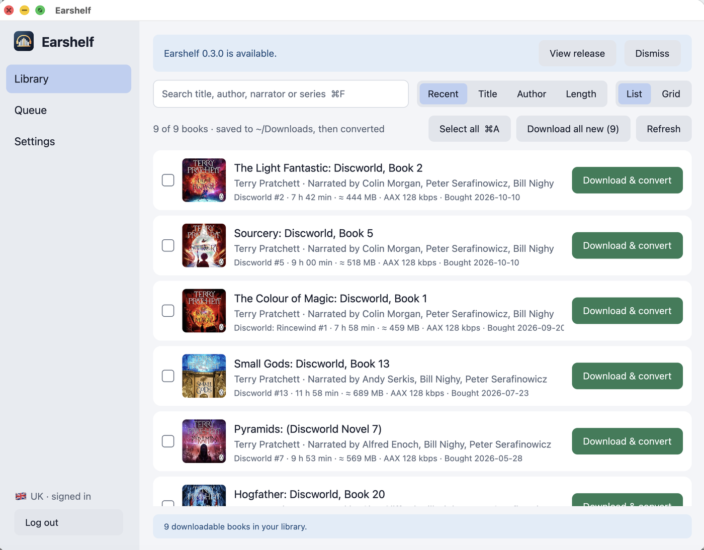

# Earshelf

A personal macOS GPUI app for downloading your own Audible books and converting AAX/AAXC files into lossless, chapter-separated M4A files.



**For audiobooks you own only.** Use it to keep personal, DRM-free copies of books you bought on your own Audible account. Do not use it to share or distribute audiobooks. You are responsible for following your local laws and Audible's terms.

## Install

Requires macOS 12+ on Apple Silicon and uv (`brew install uv`). FFmpeg is included; the 1Password CLI is optional.

```sh
curl -fsSL https://github.com/Mokto/earshelf/releases/latest/download/Earshelf-macos-universal.zip -o /tmp/earshelf.zip
ditto -x -k /tmp/earshelf.zip /Applications && rm /tmp/earshelf.zip
```

The app is ad-hoc signed, not notarized (that needs a paid Apple Developer account). Files downloaded with `curl` are not quarantined, so it opens normally. If you download the zip from [Releases](https://github.com/Mokto/earshelf/releases) with a browser instead, macOS blocks the first launch: open the app once, then use **System Settings → Privacy & Security → Open Anyway**, or run `xattr -dr com.apple.quarantine "/Applications/Earshelf.app"`.

## Run from source

Requires Rust, the macOS Command Line Tools, uv, and FFmpeg:

```sh
brew install rust uv ffmpeg
xcode-select --install
uv sync --locked
cargo run --locked
```

From Finder:

```sh
bash scripts/bundle.sh
open "dist/Earshelf.app"
```

Use `bash scripts/bundle.sh release` for an optimized build. The bundle includes a native Swift/WebKit login helper, the Python helper and its dependency lockfile, and a minimal static FFmpeg/ffprobe, but still requires installed uv. `scripts/build-ffmpeg.sh` builds FFmpeg 9.0.2 from the checksum-pinned upstream tarball (about a minute, cached in `target/`) with only the components conversion needs, LGPL-only; its license and source reference ship in `Contents/Resources/ffmpeg`. Homebrew FFmpeg is still used by `cargo run` and the tests. Cargo compiles the native helper with the macOS Command Line Tools. On first launch uv prepares a Python environment in `~/Library/Caches/earshelf/python`; this can require internet access. The bundle is ad-hoc signed, not developer-signed or notarized. It is a personal app, not a standalone distribution.

GPUI is pinned to 0.2.2. The `font-kit` feature enables native macOS text rendering; disabling it silently selects a no-op text renderer. Metal shaders compile at runtime, so the full Xcode app is not required.

## Logged out: sign-in view

The app has two views. Without saved activation bytes it shows only sign-in and marketplace selection. With saved activation bytes it shows only the audiobook conversion queue and **Logout**. Existing activation bytes restore the logged-in view on launch.

1. Choose the marketplace where your Audible library lives (UK, US, DE, AU, CA, or FR).
2. Click **Log in with Amazon**. A native WebKit window opens Amazon's sign-in page.
3. Complete sign-in, including MFA/CAPTCHA, in that window.
4. The window intercepts the expected Amazon redirect before its error page loads. It forwards the temporary authorization code to the existing Python login session, preserving its PKCE verifier.
5. The window closes, the helper fetches the account's eight-character activation bytes, and the app switches to the conversion view. No copying required.

The sign-in window uses an ephemeral WebKit data store. It permits top-level navigation only to HTTPS pages on the selected Amazon domain and captures only a matching top-level redirect with a single nonempty authorization code. Closing the sign-in window cancels authentication without touching your audiobook files.

Sign-in is embedded-only. There is no external-browser fallback or copied-URL flow. If Amazon cannot load, the window shows an error and offers **Retry sign-in** or **Cancel**. Clipboard editing works normally inside Amazon's fields. Passwords can be filled through the optional 1Password CLI integration below; Authenticator OTPs can also be filled; SMS/email verification codes and CAPTCHA remain manual.

Existing `~/.audible/activation_bytes` is picked up automatically. On the sign-in view, you can also copy an eight-character key and click **Use copied activation bytes**.

Passwords are entered only into Amazon's own page. The app never extracts existing page passwords or saves passwords. With 1Password CLI autofill, it handles the selected username/password in memory and sends them through WebKit argument bindings, not string-interpolated JavaScript. Redirect URLs travel through private process pipes, exist only in memory, and are not logged. The native window discards its cookie store when it closes. The Python helper stores the registered Audible device credentials (tokens and device key, never your password) in the macOS Keychain so the library can be listed and downloaded. The activation-byte file is saved atomically with mode 0600; the optional non-secret 1Password item reference is saved in app preferences. The app does not copy sign-in URLs to the clipboard.

Login uses the unofficial Python `audible` API. Amazon changes may break it. Legacy Audible username login is not implemented. Each login registers an Audible device; **Logout** deregisters it.

### 1Password CLI autofill

Requires 1Password 8 for Mac and 1Password CLI (`brew install --cask 1password-cli`). In **1Password → Settings → Developer**, enable **Integrate with 1Password CLI**. Enable Touch ID in 1Password if you want biometric approval.

1. Open the embedded Amazon sign-in window and click **Fill with 1Password**.
2. Approve any 1Password access prompts. The app searches all configured accounts and all their vaults without an account-selection prompt. Unavailable accounts are reported, not silently omitted.
3. Click one of the large login rows. Each row shows the item, vault, and account (plus the username hint when available). Only Login items with Amazon/Audible website URLs are offered. Metadata is listed across accounts, but credentials are read only for the selected item.
4. The app fills empty username/password fields. Click Amazon's **Continue** or **Sign in** yourself. Passwords are automatically filled on the next page using the same choice.
5. On an authenticator-app challenge, the app gets a fresh OTP from the selected item's stored OTP field using `op item get --otp` and fills it without submitting. Click Amazon's **Verify** yourself. If the code expires, clear the field and click **Fill with 1Password** again. SMS/email codes and CAPTCHA remain manual.

The account/vault/item IDs are remembered separately for each marketplace, so future sign-ins autofill after any required 1Password approval. The **⋯** button beside **Fill with 1Password** lets you choose another login, forget the choice, or open 1Password's CLI settings. Logout does not remove this non-secret choice or lock 1Password.

CLI authorization is account-wide, not item-scoped. The app uses the desktop integration (never inherited service-account tokens), disables CLI caching, and launches the signed CLI directly without a simulated terminal. CLI stdout is consumed through a private pipe; bounded stderr is classified into fixed failure messages, never displayed or logged as raw text. Passwords and OTPs never go on the clipboard, in command-line arguments, in app events, or into saved settings. The app does not compute OTPs itself or retain the OTP seed. No master password or service-account token is requested by the app.

Filling is restricted to the original HTTPS Amazon host, `/ap/` pages, and the main frame. Navigation/document changes, ambiguous fields, existing input, and mismatched or unidentifiable password-page accounts prevent unsafe filling. Automatic OTP filling is bound to the login already filled in that sign-in session. TOTP detection uses visible English/German/French authenticator prompts and Amazon's code field identifiers; SMS/email challenges are excluded. Choosing another login clears the old choice. If CLI access is denied, unavailable, or times out, the app shows setup guidance and leaves manual sign-in available. Cancelling sign-in terminates the active CLI process.

This is app-managed autofill, not a hosted 1Password browser extension. Live desktop approval and Amazon compatibility still require verification with your account.

## Logged in: conversion view

**Logout** deregisters this app's Audible device, removes the Keychain sign-in and `~/.audible/activation_bytes`, clears the in-app queue, and returns to the sign-in view. If Amazon cannot be reached, local data is still removed and the app asks you to remove the device under Amazon's Content and Devices settings. It does not delete original audiobooks, converted files, or unrelated authentication files. Logout is disabled during a background operation; stop conversion first.

Logout is local to this Mac. Because the activation-byte file is shared with the existing CLI conversion script, that script will also need activation bytes again. Logout does not sign out of Amazon in your regular browser.

## Audible library

Click **Audible library** to list the downloadable single-part books in your library, newest purchases first. **Download & convert** adds a book to the queue; it downloads to `~/Downloads` and then converts like any other file.

- AAX is requested first and decrypts with your activation bytes. Titles without AAX fall back to AAXC; its per-book key and IV are saved next to it as a mode-0600 `.voucher` file.
- Downloads stream into a hidden staging directory and publish with an exclusive rename. Incomplete or cancelled downloads are discarded; existing files are never overwritten. An existing download with the same name is reused.
- Cover artwork shows in library and queue rows. Covers download in the background after the list appears and are cached in `~/Library/Caches/earshelf/covers`; only HTTPS image responses up to 4 MB are kept.
- Multi-part books, podcasts, and titles without offline rights are not listed.
- Accounts connected by pasting activation bytes cannot browse the library; log out and log in with Amazon.

## Convert

Add or drag in AAX/AAXC files, or download from the library, then click **Convert queue**.

- Books run sequentially; progress updates after each chapter.
- Native AAC audio is copied without re-encoding.
- Chapter titles, album, author, track numbers, and available cover art are preserved.
- Outputs appear in a book-title folder next to the original file.
- Conversion stages the entire book in a hidden temporary directory and publishes it using an exclusive macOS rename.
- Existing output folders are never replaced, even if empty.
- The original AAX files are never changed or deleted.
- A failed book stops the queue. Use **Queue again**, then **Convert queue**.
- Cancellation stops FFmpeg and removes normal staging output. A forced quit or power loss can leave a hidden `.earshelf-*` temporary directory next to the source; it is not treated as completed output.

M4A only. No player, library sync, or MP3. Manually added AAXC files need the matching `.voucher` next to them.

## Keyboard shortcuts

| Shortcut | Action |
|---|---|
| ⌘O | Add files |
| ⌘L | Log in using a native sign-in window |
| ⌥⌘L | Logout and forget saved activation bytes |
| ⇧⌘V | Paste activation bytes |
| ⌘R | Convert queue |
| Esc | Cancel |
| ⌘Q | Quit |

In the native sign-in window, ⌘R retries sign-in, ⌘W closes the window, and the standard Cut/Copy/Paste/Select All shortcuts work on Amazon's fields. Core workflows have keyboard shortcuts. Full VoiceOver support is not implemented in this GPUI prototype.

## App icon

The app uses a custom midnight-blue macOS tile with a gold open shackle, an audiobook, and a waveform. The icon includes standard and Retina sizes from 16 to 1024 pixels.

Editable vector artwork is in `scripts/draw-icon.swift`. Regenerate the PNG and ICNS assets with `bash scripts/make-icon.sh`, then rebuild the app bundle. No design-tool dependencies are required.

## Checks

```sh
cargo fmt --check
cargo clippy --locked -- -D warnings
cargo test --locked
cargo run --locked -- --check-text
uv run --locked python -W error::ResourceWarning -m unittest discover -s backend -v
```

Tests include a real offline WebKit two-step autofill check with fake credentials (including quotes, HTML, and Unicode), leading-zero OTP filling, refusal of mismatched accounts, SMS challenges, CAPTCHA, existing/ambiguous fields, and stale origins/documents, all-account discovery with partial failures, large picker rows and safe cancellation, consecutive noninteractive CLI commands, safe error classification, CLI cancellation/timeouts, credential validation, and login/conversion blocking states, native redirect validation and ephemeral storage, an actual offline WebKit redirect interception, redirect/key validation, private key-file permissions, Keychain round-trips with an in-memory keyring, device deregistration on logout, library filtering and codec choice, local-HTTP download publication/cancellation, AAXC voucher validation, logout and failed-logout preservation, cancellation, cleanup, exclusive publication, and real FFmpeg chapter splitting with artwork and metadata (also run against the bundled minimal FFmpeg once `scripts/build-ffmpeg.sh` has built it). The WebKit integration test briefly opens a native window and requires a macOS desktop session. These checks do not validate live Amazon authentication, library listing, or downloads.

## License

MIT — see [LICENSE](LICENSE).
